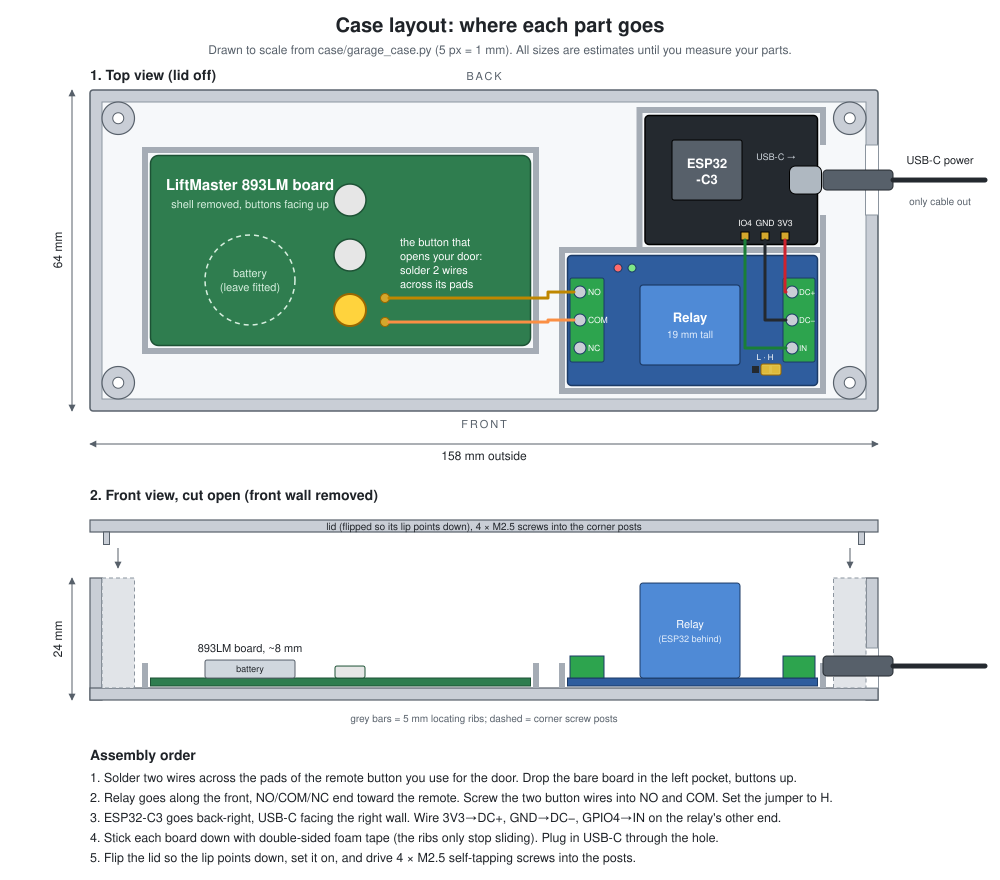

# 3D-printable case

`garage_case.py` is a parametric Blender script that builds a two-part case (base + lid) for the ESP32-C3 controller, the relay module and the bare LiftMaster 893LM remote board. Open it in Blender's Scripting workspace and run it. Set `EXPORT_DIR` to also write STL files.

All dimensions in the script are estimates. Measure your parts with calipers and edit the numbers at the top of the script before printing. This matters most for the 893LM board, which is used without its plastic shell.

## Placement

| Pocket | Part | Orientation |
| --- | --- | --- |
| Left | LiftMaster 893LM board, shell removed | Buttons up, battery left in |
| Front, right of the remote | 1-channel 3.3V optocoupler relay module (about 50 × 26 mm, screw terminals at both ends) | NO/COM/NC end facing the remote, DC+/DC−/IN end on the right |
| Back-right | ESP32-C3 | USB-C port facing the hole in the right wall |

The locating ribs are only 5 mm tall and don't clamp anything. Hold each board down with double-sided foam tape. The USB-C power cable is the only cable that leaves the case.

## Less material, vents and logo

- **Vent grille.** Slots run across the lid and floor over the relay/ESP column. That saves plastic and lets the relay's heat out. The remote's pocket floor stays solid so its foam tape has something to stick to. Tune `GRILLE_W`, `GRILLE_PITCH` and `FLOOR_GRILLE`.
- **Logo.** A closed-garage icon (house outline with door slats) is engraved 0.8 mm into the lid's outer face, over the remote. Set `LOGO = False` to skip it. It is on the face that sits on the print bed. Flip the lid about its short (Y) axis when assembling so the roof points up.

## Wiring inside the case

| ESP32-C3 | Relay input terminal |
| --- | --- |
| 3V3 | DC+ |
| GND | DC− |
| GPIO4 | IN |

| Relay output terminal | Connects to |
| --- | --- |
| COM | One pad of the door button on the 893LM board |
| NO | The other pad of that button |
| NC | Unused |

Set the relay's H/L trigger jumper to **H**. That matches the firmware default `RELAY_ACTIVE_LOW false`. If you put it on L, set `RELAY_ACTIVE_LOW true` in `src/config.h`.

This relay has a 3V coil. Power DC+ from the ESP32's 3V3 pin, not from 5V.
