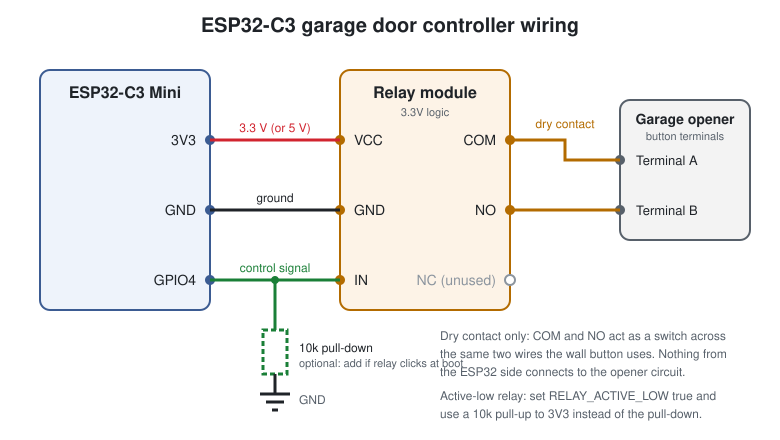

# ESP32-C3 Garage Door Controller

Drop-in replacement for the Raspberry Pi controller (`garage_door_opener.py`). It uses the same device ID, MQTT topics and Home Assistant `cover` entity, so Home Assistant and your automations don't notice the swap. The separate reed-switch sensor in [../esp32-c3](../esp32-c3/README.md) is unchanged and keeps reporting the real door state.

## Wiring

| ESP32-C3 | Relay module |
| --- | --- |
| 3V3 (or 5V if the module needs it) | VCC |
| GND | GND |
| GPIO4 | IN |

| Relay contact | Connects to |
| --- | --- |
| COM | Garage button wire A |
| NO | Garage button wire B |
| NC | Unused |

Optional: a 10k pull-down resistor from GPIO4 to GND. GPIO4 floats for a few hundred milliseconds after reset, before the firmware drives it, and on some relay modules that can make the relay twitch at power-up. Many modules have their own pull-down and don't need it. Power-cycle the board a dozen times while watching the relay; add the resistor only if it clicks. If your module is active-low, set `RELAY_ACTIVE_LOW true` and use a 10k pull-up to 3V3 instead.



Text version:

```text
        ESP32-C3 Mini                      Relay module (3.3V logic)
      ┌──────────────┐                    ┌─────────────────────────┐
      │          3V3 ├────────────────────┤ VCC                     │
      │              │                    │                         │
      │          GND ├──────────┬─────────┤ GND                     │
      │              │          │         │                         │
      │        GPIO4 ├───┬──────┼─────────┤ IN                      │
      │              │   │      │         │                         │
      └──────────────┘   │      │         │ ── contact side ──      │
                         │      │         │                         │
                       [10k]    │         │ COM ●──────────────┐    │
                       pull-    │         │ NO  ●───────────┐  │    │
                       down     │         │ NC  ● (unused)  │  │    │
                         │      │         └─────────────────┼──┼────┘
                         └──────┘                           │  │
                          to GND                            │  │
                                                            │  │
                          Garage opener button terminals    │  │
                        ┌───────────────────────────────┐   │  │
                        │  Terminal A  ◄────────────────┼───┼──┘
                        │  Terminal B  ◄────────────────┼───┘
                        └───────────────────────────────┘
                        (the same two wires the wall button uses)
```

COM and NO act as a dry contact across the two button wires. It doesn't matter which wire goes to COM and which to NO. If the relay doesn't click reliably on 3V3, power its VCC from the C3's 5V pin; the 3.3V logic on IN is still fine.

## Configure, build, flash

```powershell
cd esp32-c3-controller
copy src\config.example.h src\config.h   # then edit Wi-Fi and MQTT values
python -m platformio run --target upload --upload-port COM3
```

`src/config.h` is gitignored.

## Behavior

- Subscribes to `garage_door/garage_door_pi/set` and accepts `open`, `close`, `toggle`, `stop`.
- Each accepted command pulses the relay for `RELAY_ACTIVATION_MS`, then reports `opening`/`closing` and, after `TRAVEL_TIME_MS`, `open`/`closed`.
- Commands that arrive while the door is moving are ignored. The exception is `stop`, which pulses the relay and reports `open` (a halted door is partly open).
- Retained commands are never acted on. PubSubClient can't see the retain flag, so commands in the first `COMMAND_GRACE_MS` after subscribing are dropped.
- The relay is driven inactive as the first line of `setup()`. A Wi-Fi or MQTT loss never pulses it.
- The assumed state is saved to flash, so a power cycle doesn't reset it to `INITIAL_STATE`.
- Wi-Fi modem sleep is on to reduce idle power.

## Cutover from the Raspberry Pi

1. Wire and flash the new C3 on the bench first. With the relay contacts not yet connected to the opener, watch the serial output and the relay click on `open`, `close` and `toggle`.
2. Stop the Pi: `sudo systemctl disable --now garage-door-opener`. Two devices must never use the same MQTT client ID, or they will keep kicking each other off the broker.
3. Move the two button wires from the Pi's relay to the new relay (COM and NO).
4. Power the C3. The entity in Home Assistant should come back as `Garage Door` with no changes.
5. Test with the door path clear.

Note that `stop` and `open`/`close` behave exactly as before: the state is assumed, not measured. Use the reed-switch sensor for the real state.
